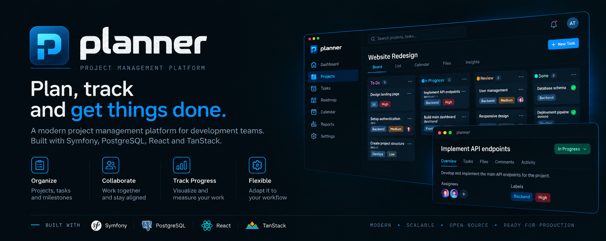

<p align="center">
  
</p>

# Boilerplate Planner

Boilerplate Planner is a project-management application with an independent React SPA and a
Symfony DDD/CQRS backend. It does not use Laravel, Blade, or Inertia.

## Table of Contents

- [Stack](#stack)
- [Getting Started](#getting-started)
- [Planner Domain](#planner-domain)
- [External API](#external-api)
- [Documentation](#documentation)
- [Repository Structure](#repository-structure)

## Stack

- Symfony 7.4 LTS / PHP 8.4, Doctrine ORM, and PostgreSQL 16.
- Internal `/api/*` API with JWT in httpOnly cookies and double-submit CSRF protection.
- External `/api/v1/*` API with API Platform 5, Bearer tokens, and resource scopes.
- React 19, TypeScript, Vite, React Router, TanStack Query, and shadcn/ui.
- Docker Compose services for the backend, worker, frontend, PostgreSQL, nginx, and Mailpit.

## Getting Started

Requirements: Docker with the Compose v2 plugin and `make`. The project uses dedicated ports to
avoid conflicts with other local services:

```bash
cp .env.example .env
cp backend/.env.example backend/.env
make up
make ps
```

On first startup, the backend installs Composer dependencies, generates JWT keys, runs database
migrations, and loads the seed data. Wait until `make ps` reports healthy services before using
the application. Run `make seed` to reload the seed data.

- Application: http://localhost:8093
- External API docs: http://localhost:8093/api/v1/docs
- Mailpit: http://localhost:8025
- Demo login: `admin@admin.com` / `admin123`

`make seed-force` rebuilds the DEMO project and its issues, epics, sprints, comments, checklist,
worklogs, and activity. `make down` stops the services and preserves the database. The backend
entrypoint runs migrations at startup; run `make migrate` to apply them manually.

## Planner Domain

Bounded contexts include Project, Issue, Planning (epics and sprints), Auth, Notification, and
Dashboard. The demo seeds the source project's `DEMO` dataset with 14 issues, 4 epics, 4 sprints,
and their comments, checklist items, links, activity, and worklogs. Demo users are also available:
`Laura Gómez`, `Marcos Ruiz`, and `Elena Torres` (password: `demo123`).

## External API

The external API uses API Platform 5 and API clients created under **Users → API Clients**. Select
the required scopes when creating a client; its secret is shown only once. Planner scopes are:

- `projects:read`: list and search all projects.
- `tasks:read`: list, search, and retrieve tasks across all projects.
- `tasks:write`: create and replace tasks, and change their status.
- `*`: full access to every available resource and operation.

Projects are read-only through the external API. Project creation remains an internal operation
because it requires assigning an application user as the owner. External tasks are represented by
the internal `Issue` context.

Exchange a `clientId` and `clientSecret` for a token:

```bash
curl --request POST http://localhost:8093/api/v1/auth/token \
  --header 'Content-Type: application/ld+json' \
  --header 'Accept: application/ld+json' \
  --data '{"clientId":"<CLIENT_ID>","clientSecret":"<CLIENT_SECRET>"}'
```

Send the returned `accessToken` as `Authorization: Bearer <ACCESS_TOKEN>`. Access tokens expire
after one hour and can be renewed with `POST /api/v1/auth/refresh` and the `refreshToken`. Requesting
a new token with a client's credentials invalidates that client's previous token.

| Method | Route | Required scope |
| --- | --- | --- |
| `GET` | `/api/v1/projects` | `projects:read` |
| `QUERY` | `/api/v1/projects/search` | `projects:read` |
| `GET` | `/api/v1/tasks` | `tasks:read` |
| `GET` | `/api/v1/tasks/{id}` | `tasks:read` |
| `QUERY` | `/api/v1/tasks/search` | `tasks:read` |
| `POST` | `/api/v1/tasks` | `tasks:write` |
| `PUT` | `/api/v1/tasks/{id}` | `tasks:write` |
| `PATCH` | `/api/v1/tasks/{id}/status` | `tasks:write` |

The `QUERY` operations use API Platform 5's HTTP `QUERY` method and accept search criteria as JSON
in the request body, for example `{"projectId":1,"status":"in_progress","search":"login"}`.
Interactive OpenAPI documentation is available at [`/api/v1/docs`](http://localhost:8093/api/v1/docs).

## Documentation

- [Planner architecture and bounded contexts](docs/ARCHITECTURE-PLANNER.md)
- [Backend DDD/CQRS architecture](docs/ARCHITECTURE.md)

## Repository Structure

- `backend/`: Symfony application organized by layers and bounded contexts.
- `frontend/`: React/Vite SPA, including `src/`, `public/`, and Node/pnpm configuration.
- `infrastructure/`: Dockerfiles and nginx/runtime configuration.
- `docs/`: architecture decisions and guides.
- `compose*.yml`, `Makefile`, and `.env.example`: orchestration and project operations.

Node, pnpm, Vite, TypeScript, Vitest, PostCSS, Oxlint, and Prettier are configured in `frontend/`.
Docker builds and CI use that directory as the frontend working directory.

The SPA retains the visual shell and Planner modules from `boilerplate-projects_management`
(dashboard, projects, board, backlog, timeline, epics, sprints, reports, issues, and my work). It
uses React Router and consumes the API through typed services and TanStack Query. Inertia, Eloquent
models, and Laravel controllers are not used; Symfony uses commands, queries, and read models in
its bounded contexts.

Run `make help` to see additional commands. Inspect services with
`docker compose -f compose.dev.yml ps`.
